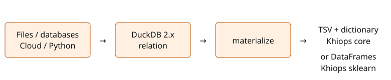

Khiops DuckDB
=============

DuckDB 2.x sources, native Khiops workflows.

``materialize`` accepts relations from your existing DuckDB connection. It does
not maintain a connector list, manage credentials, or modify Khiops.

Install from GitHub until the first PyPI release:

.. code-block:: bash

   uv pip install "git+https://github.com/KhiopsLab/khiops-duckdb.git"

.. toctree::
   :maxdepth: 2

   core/index
   sklearn/index
   sources
   semantics
   api
   demo
